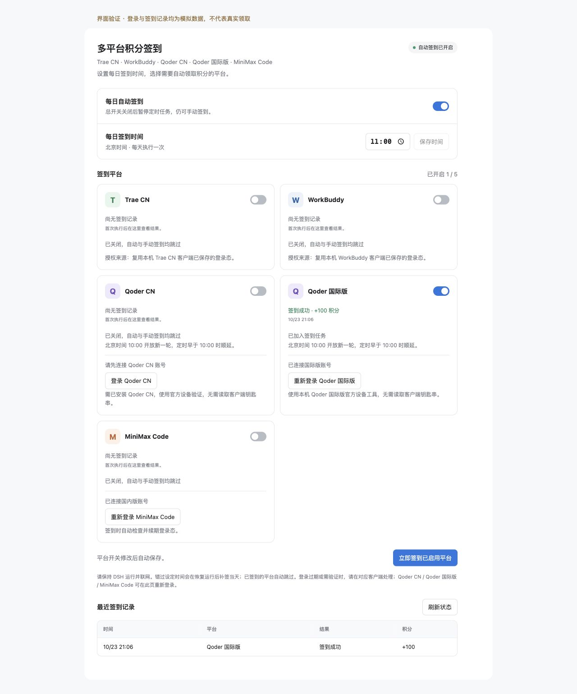

# dsh-credit-checkin-hub

使用 SnailMann DSH 插件统一的橙蓝蜗牛图标，通过 `./icon` 导出并随安装包分发。

**每天挨个打开 AI 编程工具，只为点一下「签到」？把这件小事交给 DSH。**

**dsh-credit-checkin-hub（多平台积分签到）** 是一款 **DSH Desktop 插件**，把 Trae CN、WorkBuddy 国内版、Qoder CN、Qoder 国际版和 MiniMax Code 国内版的每日积分领取放到一起。登录账号、选好平台和时间，之后由插件定时签到，少一点来回切换，也少一次「今天又忘领了」。

- **到点自动领**：默认北京时间每天 11:00 执行，时间可改，平台可单独开关。
- **错过时间会补签**：晚开电脑、睡眠后恢复运行，都能补签当天；已签过的账号自动跳过。
- **结果集中看**：谁签到了、领了多少积分、哪里需要重新登录，在同一个面板里查看。
- **想领就点一下**：随时手动签到，也可以在 DSH 对话里说「立即执行今日签到」或「查看每日签到状态」。

目前主要适配 **macOS**，已验证 DSH Desktop **0.12.1**（运行时 Node ≥ 22.19.0）。签到时需保持 DSH 运行并联网。

## 安装

尚未上架插件市场，可直接通过 DSH Desktop 安装，无需命令行：

1. 打开 DSH Desktop，点左侧栏 **「插件」**。
2. 点 **「添加插件」** → **「安装第三方插件」**。
3. 在「包名或地址」填入 `https://github.com/SnailMann/dsh-credit-checkin-hub`，也可填克隆后的本地仓库绝对路径（目录内需有 `package.json`）。
4. 点 **「安装」→「立即启用」**。稍后也能在「已安装插件」中找到 **「dsh-credit-checkin-hub」** 并打开开关。
5. 若提示需要重启，点菜单栏 **「Harness → 重启」**。仅刷新页面不会重载后台插件。

早期通过手写 YAML 安装过的用户，请先清理旧的插件插入登记，避免重复运行；通过插件页安装无需手改配置文件。

## 第一次使用

打开 **「设置 → 积分签到」**，或进入「插件」页中本插件的配置区：

1. 按下表完成登录，打开需要签到的平台开关。
2. 确认「每日自动签到」已开启；想换时间，修改后点 **「保存时间」**。
3. 点 **「立即签到已启用平台」** 试跑一次，在「最近签到记录」查看结果。

| 平台 | 登录方式与准备 |
| --- | --- |
| Trae CN | 先在本机国内版客户端登录，插件复用已保存的登录态。 |
| WorkBuddy 国内版 | 先在本机国内版客户端登录，插件复用已保存的登录态。 |
| Qoder CN | 点「登录 Qoder CN」，在官方网页完成登录；需安装 Qoder CN 桌面端，供官方设备验证使用。 |
| Qoder 国际版 | 点「登录 Qoder 国际版」，在官方网页完成登录；需提供国际版官方设备验证工具，通常来自 Qoder 国际版桌面端。国内版与国际版分别授权、分别记录。 |
| MiniMax Code 国内版 | 点「登录 MiniMax Code」，在官方网页完成授权，无需安装 CLI；也可复用本机官方 CLI 的国内版登录态。 |

平台开关修改后自动保存，时间和平台选择会在升级、重装后保留。登录过期时，Trae / WorkBuddy 请回客户端重新登录，Qoder / MiniMax Code 可在设置页重新授权。

## 几个常见问题

**关掉 DSH，还会自动签到吗？**

不会。下次启动或从睡眠恢复时，若已过设定时间，会补签当天，不能补领往日积分。网络或服务端临时故障（包括登录续期、账号验证超时）会自动退避重试，重启后也会保留重试进度。需要马上再试，可手动签到。

**Qoder 为什么没在我设置的时间执行？**

Qoder 每轮活动在北京时间 10:00 切换。定时时间早于 10:00 时，Qoder 会等到 10:00 后再执行，其他平台照常。

**登录成功，就一定能领到积分吗？**

还要看账号资格、当期活动和官方验证结果。到账以服务端回执为准；已签、无活动、授权失效或待确认会分别显示，请以签到记录为准。

**怎么暂停或卸载？**

设置页的「每日自动签到」只暂停定时任务，仍可手动签到；关闭单个平台后，自动和手动签到都会跳过它。要停用整个插件，在「已安装插件」中关闭开关或卸载即可，设置、记录和客户端登录态保留。

**支持其他系统和国际版客户端吗？**

Trae / WorkBuddy 的登录态自动发现及 Qoder 的设备验证目前主要适配 macOS。TRAE、WorkBuddy、MiniMax Code 国际版暂不支持。

## 许可
MIT License
